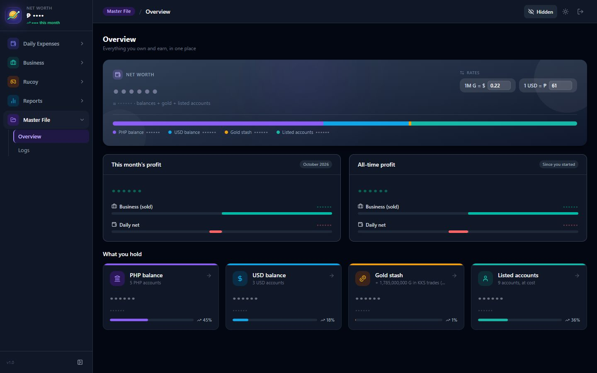
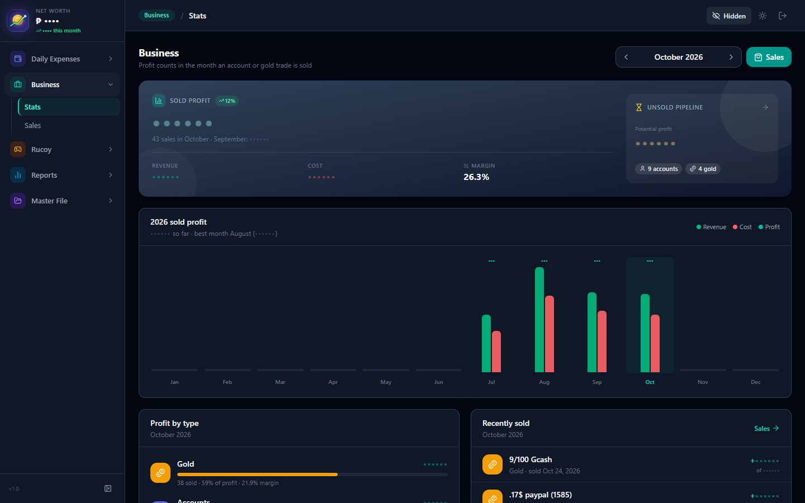
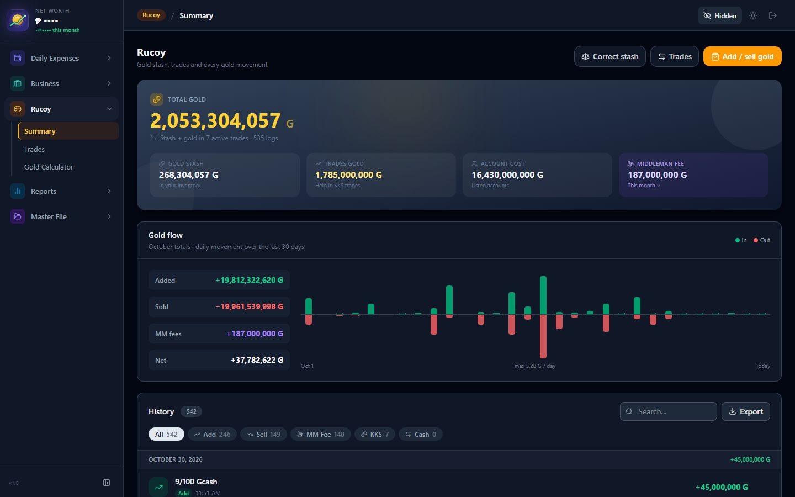

# Multi-Currency Finance & Business Dashboard

The back office I run a small online trading business on, every day. It tracks sales and profit, a
gold inventory and the trades behind it, wallets in two currencies, and daily expenses against
budgets, and it publishes listings and rates to the business's public storefront in one click.

**Laravel 12 · React 19 · TypeScript · MySQL 8 · Tailwind 4 · 363 automated tests**



## What it does

- **Net worth at a glance:** wallets in PHP and USD, the gold stash and listed stock in one total,
  with this month's and all-time profit and charts of where it comes from.
- **Sales & profit:** every sale with its price, cost and margin. All money math runs on the server
  through one summary endpoint, so the dashboard, lists and reports always show the same numbers.
- **Inventory & trades:** gold in and out, active trades with due/overdue tags, middleman fees, and
  a correction tool for when the counted stock doesn't match the records.
- **Daily budget:** expenses and income by category, budgets per category, monthly reports.
- **Reports:** weekly, monthly and yearly views with CSV export.
- **Listing Kit & publishing:** builds the sales image and caption for Discord and publishes
  listings, rates and sales counts to the storefront.
- **Undo & audit log:** any action can be undone, and every sign-in, add, edit and removal is logged
  with who did it and what changed (before → after).
- **Installable phone app (PWA) that works offline:** changes made offline wait in an outbox and
  are only sent after the owner reviews and approves them. Each change carries an
  `Idempotency-Key`, so a retry is never recorded twice.
- **Encrypted off-site backups** of the database to Cloudflare R2 (see [docs/BACKUP.md](docs/BACKUP.md)).

| Business stats | Gold summary |
| --- | --- |
|  |  |

Amounts in the screenshots are hidden with the app's own privacy toggle.

## How it's built

```
backend/    Laravel API (Sanctum tokens)
  app/Http/Requests     validation + ownership checks (Form Requests)
  app/Services          business logic: sales, inventory, summaries, trends, backups
  app/Observers         audit log for every model
  tests/Feature         authorization, validation and workflow tests
frontend/   React + Vite SPA
  src/pages             screens (layout and wiring only)
  src/hooks             data and state
  src/components        shared UI, including the chart kit
  src/lib/offline       IndexedDB cache, outbox, sync review, service worker
```

- Controllers stay thin: validate, authorize, call a service, return.
- The server never trusts the client for owner or status; it derives them from the signed-in user.
- Runs on a private server reached over Tailscale, with no port open to the internet.

## Running it locally

Requirements: PHP 8.2+, Composer, Node 20+, MySQL 8.

```bash
# Backend
cd backend
composer install
cp .env.example .env          # set DB_DATABASE / DB_USERNAME / DB_PASSWORD
php artisan key:generate
php artisan migrate --seed
php artisan serve

# Frontend (in another terminal)
cd frontend
npm install
npm run dev
```

For a database full of invented sample data (for demos and screenshots), seed a **scratch**
database instead:

```bash
php artisan migrate:fresh --seed --seeder=DemoSeeder
```

## Tests

```bash
cd backend && php artisan test          # 185 feature/unit tests (uses a separate test database)
cd frontend && npm test                 # 178 Vitest tests
cd frontend && npm run typecheck && npm run lint
```
